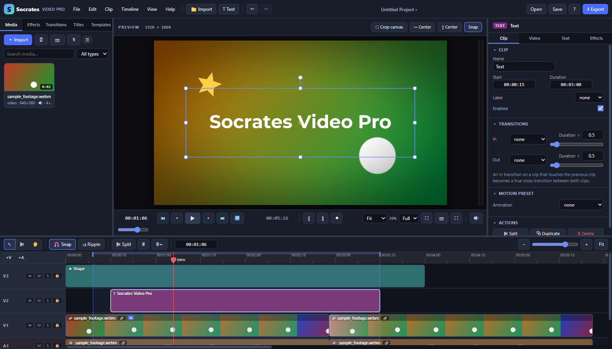

# Socrates Video Pro

A local, multitrack video editor for the web and Windows. Edit, animate, mix, and export on your own machine. The browser app has no runtime dependencies or build step; the optional Windows app bundles Chromium with Electron.



## Install and run

Download the latest files from [Releases](https://github.com/NotThatRandomGuy/socrates-video-pro/releases/latest):

| Download | How to use it |
| --- | --- |
| `Socrates-Video-Pro-1.0.0-Setup-x64.exe` | Windows 10/11, 64-bit. Run the installer, choose a folder, and launch from Start or the desktop shortcut. Uninstall through Windows Settings. |
| `Socrates-Video-Pro-1.0.0-Portable-x64.exe` | Place in a writable folder and run. No installation is required. Recovery and media cache live in the adjacent `SocratesVideoPro-data` folder; keep that folder with the executable when moving it. |
| `Socrates-Video-Pro-Web.zip` | Extract and open `index.html` in current Chrome or Edge. You can also serve the extracted files from any static web host. |

The Windows packages are unsigned. Windows may display an unknown-publisher warning. Verify the download source and the release's `SHA256SUMS.txt` before running it. No signing certificate is included in this repository.

To run the source in a browser, download or clone this repository and open `index.html`. Alternatively, with Node.js 24 installed, run `node scripts/serve.mjs` and open [localhost:8765](http://localhost:8765). Recording requires a secure context: HTTPS, localhost, or the desktop app. Support for file-based recording depends on your browser.

## Start editing

1. Click **Import**, or drop video, audio, or images into the Media panel. Drag a media item onto the timeline. Double-clicking a media item also adds it.
2. Drag clips to arrange them, trim their edges, or press **S** to split at the playhead. Use the Inspector for transforms, text, effects, and audio controls.
3. Select a visual clip and drag it in the preview. Keep **Snap** enabled to align its visible center with the canvas center. Green guides show horizontal and vertical alignment. Hold **Alt** to bypass snapping, or **Shift** to constrain movement to one axis. The two **Center** buttons align selected clips precisely; animated positions receive a keyframe at the playhead.
4. Click **Crop canvas** above the preview to frame the final output. Drag the corners to resize, drag inside to move, or drag outside to draw a new rectangle. Choose a common ratio or enter exact pixel dimensions. **Apply crop** changes the preview and export dimensions while preserving clip sizes, positions, effects, and keyframes. Reopen the dialog to revise it; **Restore original** reveals the full composition. Cropping is undoable and saved with the project.
5. Click **Save** to download a `.vep.json` project. Click **Export** for video, or use **File** for PNG frames and WAV audio.

Canvas cropping applies to the whole project. The Inspector's clip crop controls trim an individual source. Changing project resolution or applying a project template clears the canvas crop and resizes the composition. Use **Project size** in Export to retain your crop's aspect ratio; other export sizes stretch to the chosen dimensions. Video dimensions are rounded to even pixels for codec compatibility, while PNG preserves exact dimensions.

## Files, recovery, and privacy

Media editing and export happen locally. There is no upload service or account requirement. Optional Google Fonts are fetched from Google when online; offline use falls back to installed fonts, so typography can differ.

Autosave and imported media are cached in IndexedDB. Browser caches, installed-app data, and portable-app data are separate. A project file stores editing instructions and media references, **not the original media files**. Keep your originals alongside saved projects. To move a project between machines, copy both; then double-click missing items in the Media panel to relink them. Browser storage may be evicted or cleared, so autosave is recovery assistance rather than a backup.

Codec availability depends on the browser, hardware, and operating system. MP4/H.264 with AAC and WebM with Opus are offered where supported; unsupported video encoders fall back to WebM. HEVC and AV1 are optional. Unsupported source codecs may need conversion before import. Large projects require substantial RAM and disk space, and exports are assembled in memory. The Windows desktop build uses the same editor and shares these limits.

## Features

**Timeline**
- Unlimited video/audio tracks with mute / solo / lock / hide, per-track volume & pan, rename, reorder
- Select / Razor / Hand tools, multi-select (Shift/Ctrl, marquee), snapping to clip edges, playhead, markers, In/Out
- Overwrite and Ripple/Insert editing modes, ripple delete, ripple trim, close gaps, extract/lift In→Out
- Drag between tracks, Alt-drag to duplicate, linked audio/video (auto-created on import, unlink/relink)
- Frame-accurate trimming with source bounds, speed/duration (linked clips follow), freeze frame
- Markers (named/colored/ranged), In/Out points with loop playback
- Waveforms, video filmstrips, keyframe lane on clips (drag to retime, Alt-click to delete)
- Adaptive timecode ruler, Ctrl+wheel zoom at cursor, Alt+wheel track height, zoom to fit

**Compositing (per clip)**
- Position / scale (uniform or free) / rotation / anchor / opacity — all keyframeable with easing (linear, ease in/out, back, bounce, elastic, hold…)
- Fit modes (fit / fill / stretch / original), crop, rounded corners, 16 blend modes
- On-canvas gizmo: drag to move, 8 scale handles, rotation handle, Shift to constrain
- Motion presets (Ken Burns, pans, drift, float, pulse, shake, spin, bounce-in…)
- 24 transitions incl. true cross-transitions between adjacent clips (dissolve, dips, wipes, slides, push, zoom, iris, blur, spin, pop, clock, diagonal, blinds, pixelate)
- Adjustment layers (effects applied to everything below), solid/gradient generators, shapes, stickers

**Effects (GPU / WebGL2, all parameters keyframeable)**
- Color correction (exposure, brightness, contrast, saturation, vibrance, temperature, tint, hue, highlights, shadows, gamma), Lift/Gamma/Gain, Levels, 3D LUT (.cube)
- Chroma key (with color picker from preview, spill suppression), Luma key
- Gaussian blur, sharpen, glow, vignette, film grain, pixelate, posterize, invert, sepia, B&W, chromatic aberration, mirror, flip, wave distortion, drop shadow
- Shape masks (rect / ellipse / rounded) with feather, rotation, invert
- One-click Looks (Cinematic, Teal & Orange, Vintage, Noir, VHS, …)

**Text**
- Google Fonts + system fonts, weight, italic, size, letter spacing, line height, alignment, word-wrap box, case transform
- Solid/gradient fill, stroke, shadow, background box (padding/radius/opacity)
- 16 in-animations (typewriter, char/word/line reveals, pop, blur, wave…) and out-animations
- Title presets, lower thirds, captions, countdown

**Audio (Web Audio)**
- Sample-accurate scheduled playback, per-clip volume (keyframeable), pan, fades, mute, normalize
- 3-band EQ, high-pass / low-pass, presets (voice, bass boost, phone)
- Track & master mixing with solo/mute, live level meters
- Voice-over recording (with timeline playback), screen recording (with mic), webcam recording

**Export**
- Frame-accurate WebCodecs rendering (faster than real-time) to **MP4 (H.264/HEVC + AAC)** or **WebM (VP9/AV1/VP8 + Opus)** using built-in muxers
- Resolution presets up to 4K, frame rate, bitrate/quality, In→Out range, progress with ETA & cancel
- Real-time MediaRecorder fallback, WAV audio export, PNG frame export

**Project**
- Save/open `.vep.json` project files; autosave + media cache in IndexedDB (session recovery on reload)
- Missing-media relinking, undo/redo (200 steps), copy/paste/paste-attributes across tracks
- Project templates (YouTube, Reels, Square, Cinematic 24p letterbox, …), resolution/fps/background settings

## Keyboard shortcuts

Press `?` in the app for the full list. Highlights: `Space` play/pause · `J K L` shuttle · `← →` frame step · `I O` in/out · `M` marker · `S` split · `C V H` razor/select/hand · `N` snap · `R` ripple · `Del` delete (`Shift+Del` ripple) · `Ctrl+Z/Y` undo/redo · `Ctrl+C/X/V` clipboard · `Ctrl+D` duplicate · `Ctrl+T` text · `Ctrl+M` export · `= -` zoom · `Shift+Z` zoom to fit.

## Build from source

The web editor remains plain HTML, CSS, and JavaScript with classic scripts. Node and npm are needed only for development checks and the optional desktop packaging.

```sh
npm ci
npm start           # desktop app
npm test            # syntax + browser regression suites
npm run build:web   # static files in dist/web
npm run build:win   # Windows x64 installer and portable EXE in dist
```

Build Windows packages on Windows. Dependency versions are pinned in `package-lock.json`. The desktop renderer is sandboxed, has no Node access, and requests permission for recording. The installer supports per-user installation and directory selection. See [Electron security](https://www.electronjs.org/docs/latest/tutorial/security) and [Windows packaging](https://www.electron.build/v26/docs/nsis/) for the underlying platform documentation.

The [release workflow](.github/workflows/release.yml) tests and packages pushes to `main`, pull requests, and manual runs. Pushing a version tag such as `v1.0.0` creates a GitHub Release containing both EXEs, the web ZIP, and SHA-256 checksums after successful verification. Binaries are release assets rather than Git source files.

## Tests

```
node tests/smoke.mjs      # boots the app headless in Chrome, exercises engine + export, reports console errors
node tests/interact.mjs   # mouse/keyboard interaction tests (drag, trim, snap, marquee, gizmo, menus)
node tests/fileproto.mjs  # verifies file:// operation (direct double-click of index.html)
node tests/canvas.mjs     # crop pixels, save/load, undo, snapping, dialogs, cropped export
node tests/screenshot.mjs # renders a populated project → tests/screenshot.png
```

Requires Node ≥ 22 and Google Chrome or Edge installed. Node 24 is used in CI. Tests use isolated browser profiles and dynamically assigned local ports.

## License

[MIT](LICENSE) — Copyright (c) 2026 NotThatRandomGuy. Third-party desktop components retain their respective licenses.
